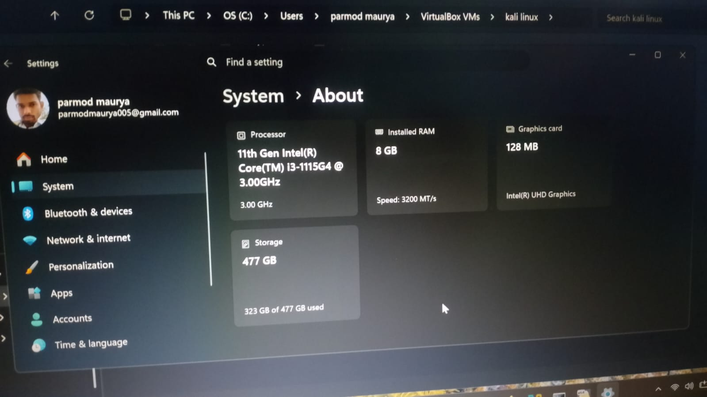
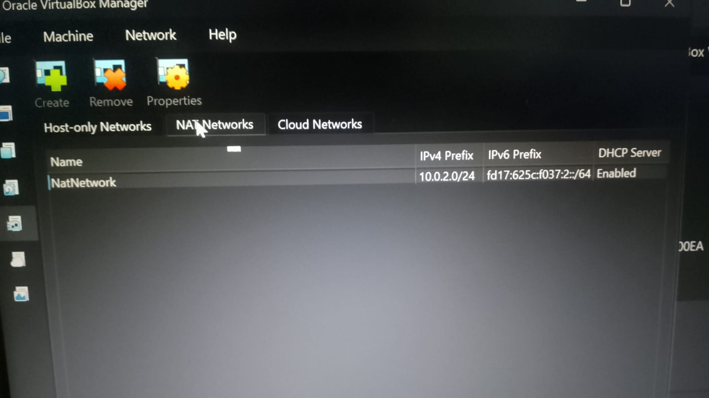
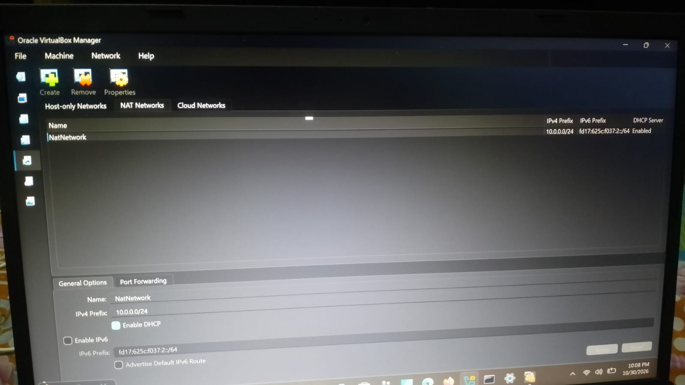
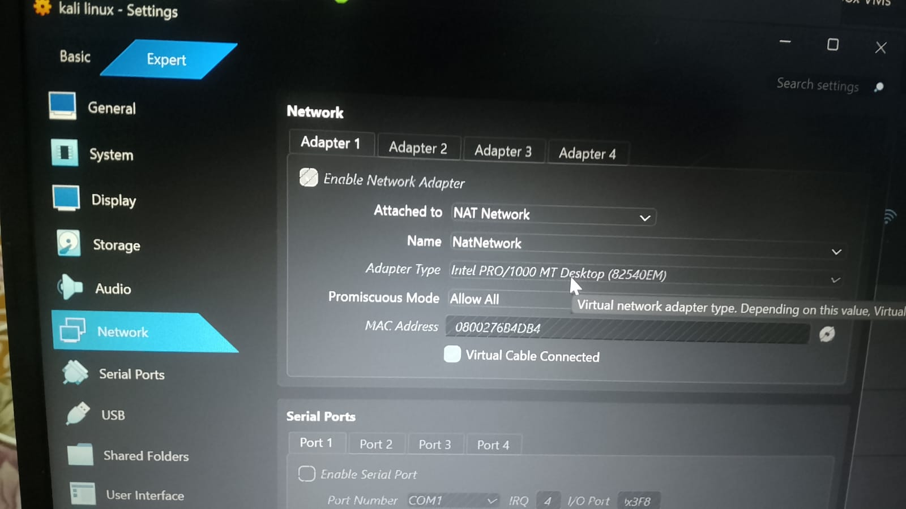
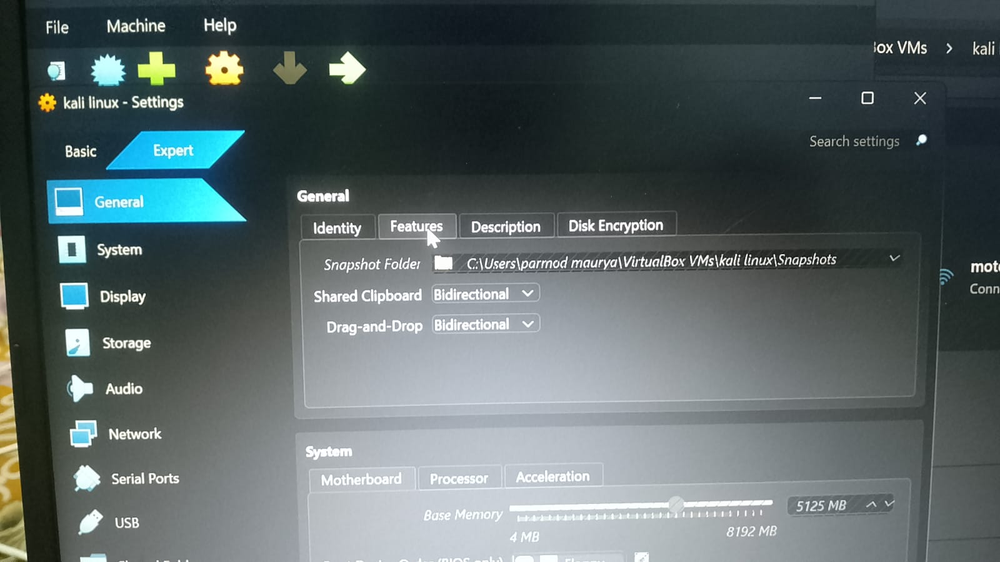
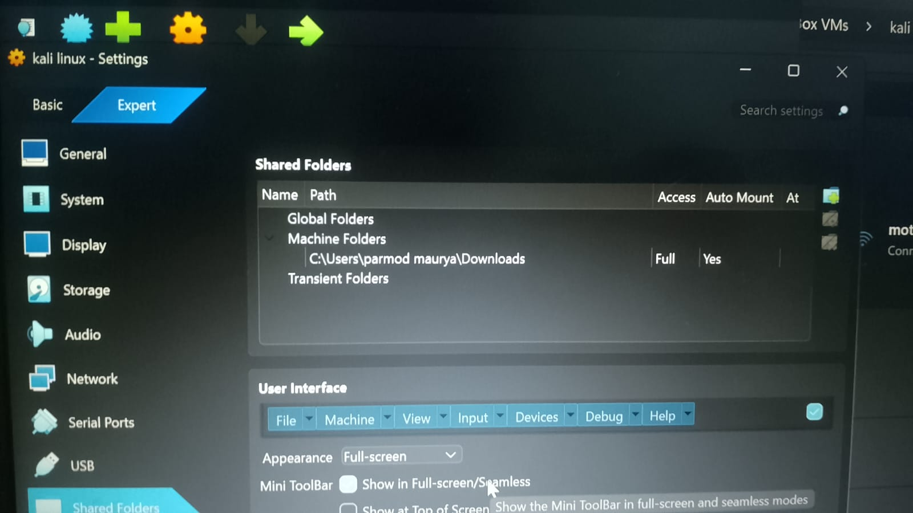
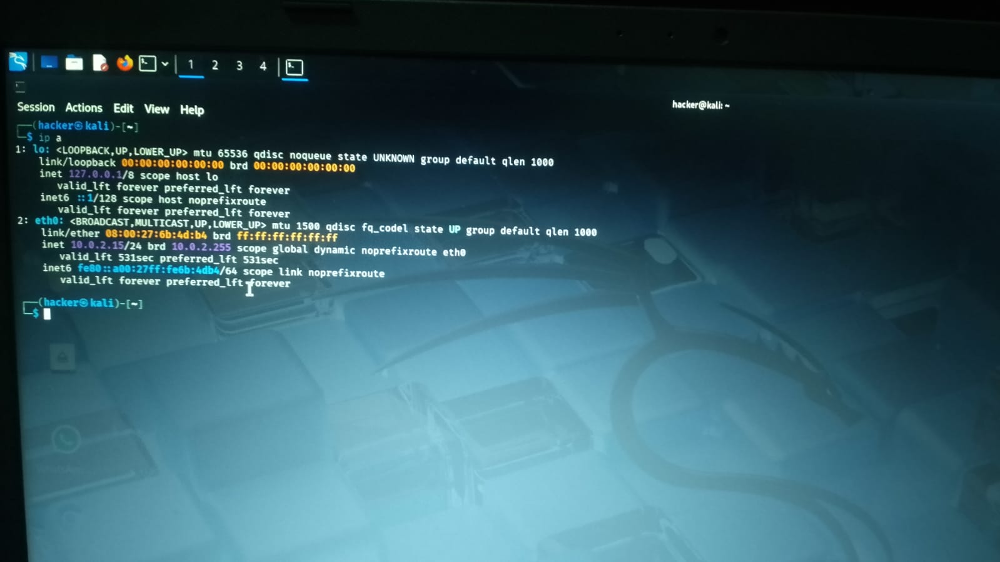
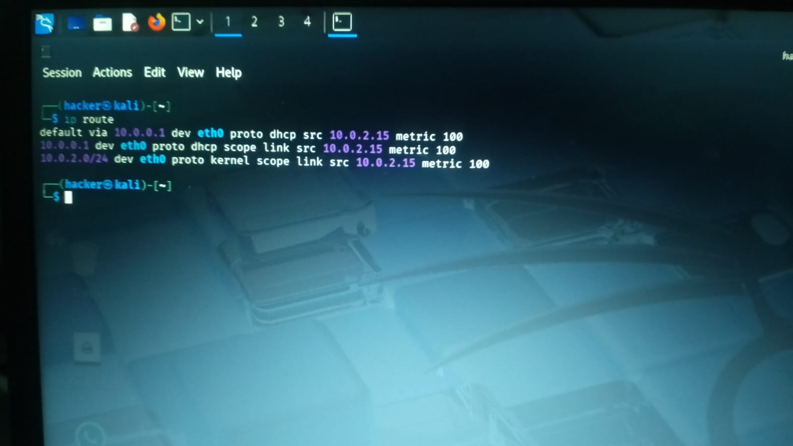
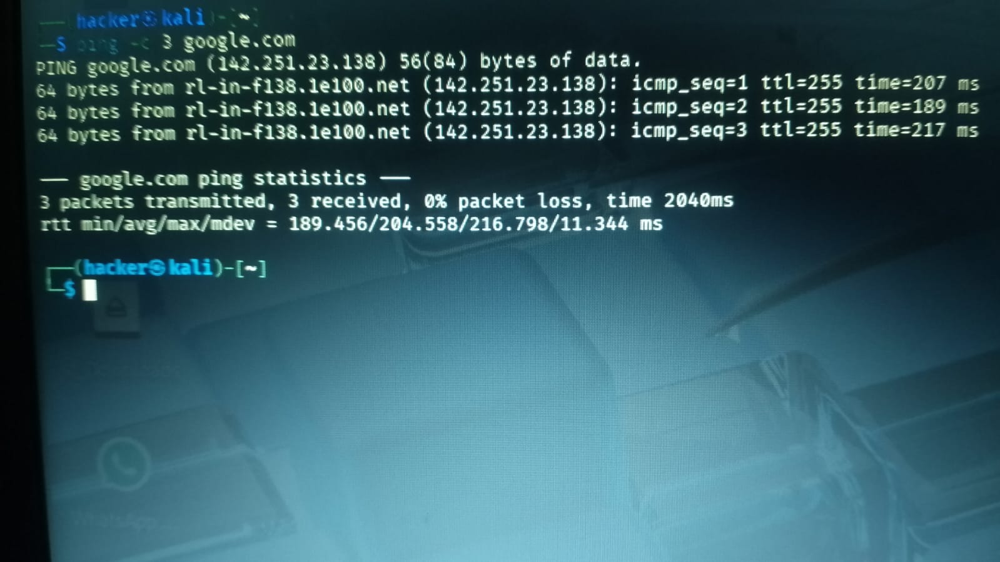

# Week 1 – Cybersecurity Lab Setup | Networkwalks Internship

**Intern:** Dinesh Singh
**Batch:** B084
**Intern ID:** NW-084-642
**Project Code:** WK1-PM1

## Objective

Set up a safe, isolated practice lab for cybersecurity learning: a Kali Linux attacker machine running inside Oracle VirtualBox on a dedicated NAT Network, with internet access, host–guest file sharing, and a restore snapshot — so every future practical can be done legally inside my own lab.

## My System Specifications

| Component | Details |
|---|---|
| Host OS | Windows 11 |
| Processor | 11th Gen Intel Core i3-1115G4 @ 3.00GHz |
| RAM | 8 GB (3200 MT/s) |
| Storage | 477 GB SSD |
| Graphics | Intel UHD Graphics |
| Virtualization | Oracle VirtualBox |
| Guest OS | Kali Linux (rolling release) |
| RAM given to VM | 5125 MB |

## Network Design

- **Network type:** NAT Network (name: `NatNetwork`)
- **Network range:** 10.0.0.0/24
- **Kali Linux IP:** 10.0.0.2/24
- **Internet:** Working (verified with ping test)

## Steps I Performed

1. Opened Oracle VirtualBox and selected my existing Kali Linux VM (powered off).
2. Opened **Tools → Network Manager → NAT Networks** and configured the NAT Network with IPv4 prefix **10.0.0.0/24** with DHCP enabled.
3. In VM **Settings → Network → Adapter 1**, attached the VM to **NAT Network (NatNetwork)**.
4. In **Settings → General → Advanced**, set **Shared Clipboard = Bidirectional** and **Drag-and-Drop = Bidirectional**.
5. In **Settings → Shared Folders**, added the host **Downloads** folder with **Full access** and **Auto-mount = Yes**.
6. Started the VM and verified the IP address with `ip a` — Kali received **10.0.0.2/24**.
7. Verified internet connectivity with `ping -c 3 google.com` — replies received successfully.
8. Took a **snapshot** of the working VM so the lab can be restored anytime.

## Screenshots

**1. Host system specifications**

**2. NAT Network list — old prefix 10.0.2.0/24 (Problem 1)**

**3. IPv4 prefix corrected to 10.0.0.0/24**

**4. VM network settings — attached to NAT Network**

**5. Clipboard & drag-and-drop — Bidirectional**

**6. Shared folder — host Downloads (Full access, Auto-mount)**

**7. Old IP lease 10.0.2.15 in `ip a` (Problem 2)**

**8. Diagnosis — `ip route` showing gateway 10.0.0.1**

**9. Ping test passed — 0% packet loss**

## Problems I Faced & How I Fixed Them

**Problem 1 — Wrong network prefix:** When I first opened the NAT Networks list, the existing network's IPv4 prefix was **10.0.2.0/24**. With that prefix, Kali could never receive the required **10.0.0.2** address. I opened the network's **Properties** and changed the IPv4 prefix to **10.0.0.0/24**.

**Problem 2 — Old IP kept coming back:** Even after the prefix change, `ip a` still showed the old address **10.0.2.15**. I diagnosed it with `ip route`: the default gateway was **10.0.0.1**, which proved the VM really was on the NAT Network (on plain NAT the gateway would be 10.0.2.2) — the DHCP was still serving the old lease. I restarted the VM so the network settings reloaded, and then verified the final state: `ip a` showed **10.0.0.2/24** and `ping -c 3 google.com` passed with **0% packet loss**.

## What I Learned

- Difference between **NAT** and **NAT Network** in VirtualBox, and why a NAT Network is used for a multi-machine lab.
- How the network prefix (CIDR) decides which IP a VM receives from DHCP.
- Why clipboard sharing, drag-and-drop and shared folders are configured for lab work.
- Why a snapshot is taken before starting practicals — a clean restore point keeps the lab safe.

## Safety Note

This lab is fully isolated inside my own laptop. All practice is done only on my own virtual machines, which is the legal and ethical way to learn cybersecurity.

---
*Week 1 project — Networkwalks Cybersecurity Internship (Batch B084)*
